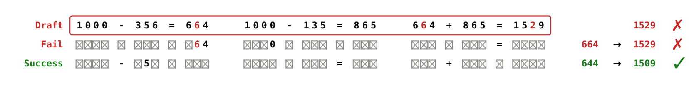
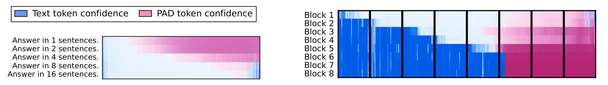
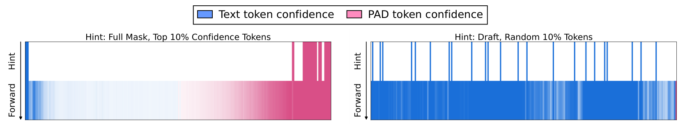
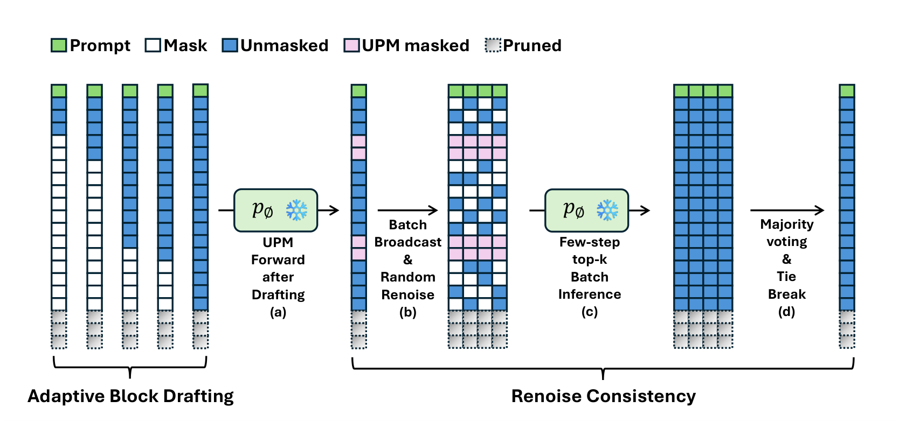
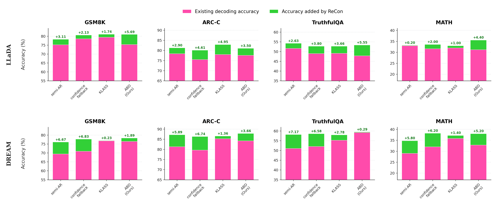
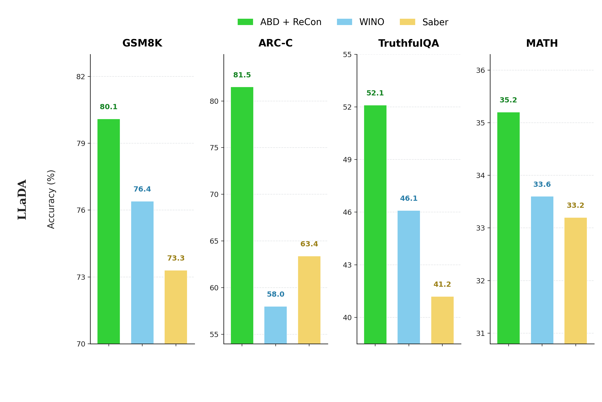

# Renoise Consistency: Unlocking Efficient Self-Correction for Diffusion Large Language Models

[](#)
[](https://jihoonlee9898.github.io/ReCon/)
[](LICENSE)
[](https://ml3.yonsei.ac.kr/)

**Jihoon Lee**<sup>1</sup>, **Yeongbin Seo**<sup>2,3</sup>, **Jaehyung Kim**<sup>1</sup>

<sup>1</sup>Yonsei University &nbsp; <sup>2</sup>University of Toronto &nbsp; <sup>3</sup>Vector Institute

 &nbsp; **NeurIPS 2026 main**

## Install

```bash
git clone https://github.com/JiHoonLee9898/ReCon.git
cd ReCon/ReCon
bash setup.sh
```

<details>
<summary>Description</summary>

- Requirements: Linux, one NVIDIA GPU (≥ 24 GB; we used a single H100), CUDA driver ≥ 12.4, Python 3.10, internet.
- `setup.sh` creates `./venv` (torch 2.6.0 + cu124, transformers 4.49.0), downloads LLaDA-8B-Instruct and
  Dream-v0-Instruct-7B into `./models` (~30 GB), and caches GSM8K, ARC-C, TruthfulQA and MATH-500.
- If `python3.10` is not on your `PATH`, pass it explicitly: `PYTHON=/path/to/python3.10 bash setup.sh`.

</details>

## Run

**semi-AR, semi-AR + ReCon, ABD and ABD + ReCon (N = 15 and 6)** for LLaDA and Dream on all 4 datasets
(about 15 hours on one H100), then print the table:

```bash
bash run.sh
```

**One model only** (`llada` or `dream`):

```bash
bash run.sh llada
```

**One model, one dataset** (`gsm8k`, `arcc`, `truthfulqa` or `math`):

```bash
bash run.sh llada gsm8k
```

<details>
<summary>Description</summary>

- All commands are run from `ReCon/ReCon`.
- Every run prints accuracy (%) and mean forward steps, and saves all generations to
  `results/<model>_<dataset>_<method>.json`.

</details>

<details>
<summary>Single rows</summary>

`run.sh` runs the rows below in this order. To run one row yourself, activate the environment first:

```bash
source venv/bin/activate
```

**semi-AR** (block 32, 128 steps). Stores its drafts for the next row:

```bash
python run_eval.py --model llada --dataset gsm8k --method semi_ar
```

**semi-AR + ReCon**. ReCon on the stored semi-AR drafts (needs the row above first):

```bash
python run_eval.py --model llada --dataset gsm8k --method semi_ar_recon
```

**ABD** (Adaptive Block Drafting). Stores its drafts for the next two rows:

```bash
python run_eval.py --model llada --dataset gsm8k --method abd
```

**ABD + ReCon** with N = 15 candidates (needs the ABD row first):

```bash
python run_eval.py --model llada --dataset gsm8k --method abd_recon
```

**ABD + ReCon** with N = 6 candidates (lightweight setting):

```bash
python run_eval.py --model llada --dataset gsm8k --method abd_recon --N 6
```

**Print the table** of everything in `results/`:

```bash
python run_eval.py --table
```

A ReCon row reuses the drafts saved by its draft row (`semi_ar` → `semi_ar_recon`, `abd` → `abd_recon`), so the
draft row has to be run first. Its steps = draft forwards + 6 ReCon forwards (1 uncertainty-aware pre-masking
forward + 5 reconstruction forwards). Other options: `--limit K` (first K examples), `--seed` (default 42),
`--model_path`, `--output_dir`.

</details>

## Motivation



<p align="center"><b>Diffusion Large Language Models (DLMs) can self-correct.</b></p>

## Abstract

Diffusion Large Language Models (DLMs) are being actively explored as promising alternatives to autoregressive models
due to their fast and flexible generation capabilities. To optimize inference in DLMs, recent studies have proposed a
variety of decoding algorithms. However, the tendency of these methods to mimic autoregressive generation limits the
speed and flexibility of DLMs, while also preventing the methods from fully realizing their potential. Moreover, this
rigid approach leads to error propagation, while existing sampling-based correction methods incur prohibitive
computational costs. To overcome this, we propose **Renoise Consistency**, a novel post-hoc approach that enables
effective self-correction by maximizing train–inference consistency and can be applied to any decoding algorithm with
a flexible computational budget. Furthermore, we introduce **Adaptive Block Drafting**, which leverages consistent
internal representations of DLMs to significantly reduce the overall computational cost. When combined, our proposed
method achieves up to a 9.00% performance improvement over the semi-autoregressive baseline, along with a 25.85%
reduction in forward steps.

## Observation



<p align="center">
Findings #1: <b>Bidirectional Inertia</b> reveals the optimal <b>output length</b> or <b>block length</b>.<br>
<b>A</b>daptive <b>B</b>lock <b>D</b>rafting (ABD), efficient drafting.
</p>



<p align="center">
Findings #2: <b>Scattered Anchor Context</b> resolves the <b>train-inference mismatch</b>.<br>
<b>Re</b>noise <b>Con</b>sistency (ReCon), efficient self-correction.
</p>

## Method



<p align="center"><b>2 step train-free inference (ABD + ReCon).</b></p>

## Takeaway

$$\mathcal{L}(\theta) \triangleq -\mathbb{E}_{t,x_0,x_t}\left[\frac{1}{t}\sum_{i=1}^{L}\mathbb{1}\left[x_t^i = M\right]\log p_\theta\left(x_0^i \mid x_t\right)\right]$$

<div align="center">

**Uniform masking** ($t \sim U[0,1]$) yields<br>
**scattered anchor contexts** **(train)**,<br>
while existing decoding methods **(inference)**<br>
impose a mismatched left-to-right prior.<br>
**ReCon** resolves this mismatch<br>
during reconstruction.

| Forward steps | Uniform random anchors | Left-sided anchors |
|:---:|:---:|:---:|
| 1 | **64.57%** | 26.50% |
| 5 | **86.56%** | 31.40% |
| 10 | **89.21%** | 48.28% |

Reconstruction success rate of initially correct GSM8K outputs (LLaDA 8B Instruct) after remasking 90% of the tokens.

</div>

## Results



<p align="center">
<b>ReCon improves drafts.</b><br>
Semi-AR: up to <b>7.17%p</b><br>
Conf. fallback: up to <b>6.83%p</b><br>
KLASS: up to <b>4.95%p</b><br>
ABD: up to <b>5.69%p</b>
</p>

<p align="center"></p>

<p align="center">
<b>ABD + ReCon outperforms lightweight revocable decodings.</b><br>
WINO: up to <b>23.5%p</b><br>
Saber: up to <b>18.1%p</b>
</p>

## Citation

Coming soon.

## License

This code is released under the [MIT License](LICENSE). The generation code is based on the official inference code of
[LLaDA](https://github.com/ML-GSAI/LLaDA) and [Dream](https://github.com/HKUNLP/Dream).
